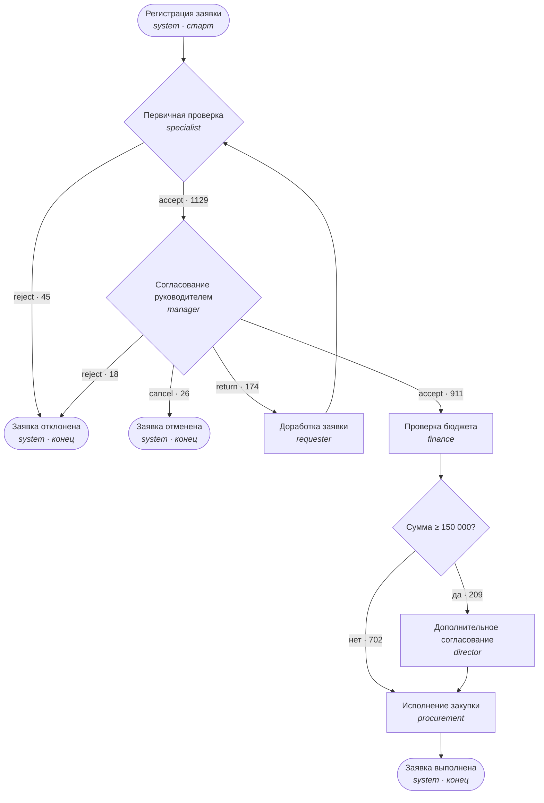

# Восстановление процесса закупок по журналу событий (Кейс 2)

## 1. Схема восстановленного процесса

**Легенда:** прямоугольник — человеческое задание (в скобках — роль фактического исполнителя); ромб — развилка/решение; скруглённый прямоугольник — граница экземпляра (`system`). Подписи на стрелках — результат действия и число наблюдений в журнале. Пунктирная стрелка «Доработка → Первичная проверка» — повторное выполнение (возврат).

## 2. Инструменты и воспроизводимые шаги

Журнал (`students.csv`, 1000 процессов, 6508 событий) обработан на Python 3 + pandas. Шаги:

1. Загрузил CSV (UTF-8 с BOM), все идентификаторы — как текст; `EventIndex` — числовой.
2. Сгруппировал строки по `ProcessInstanceId` и внутри каждой группы отсортировал по числовому `EventIndex` — так восстановил последовательность действий каждой заявки.
3. Для каждого экземпляра собрал маршрут `ActivityName[1] > ActivityName[2] > …` и посчитал частоту каждого уникального маршрута.
4. Посчитал пары непосредственно следующих активностей (Directly-Follows) и кросс-таблицы «активность × роль», «активность × результат».
5. Проверил, чем отличаются случаи с активностью «Дополнительное согласование», — сравнил распределение `Amount` для обеих групп.

Скрипт `generate.py` воспроизводит `variants.csv` и `student_transitions.csv`; итоговая схема и отчёт основаны на этих подсчётах.

## 3. Активности, начала и окончания

| Активность | Роль | Всего выполнений | Результаты |
|---|---|---|---|
| Регистрация заявки | system | 1000 | — (старт) |
| Первичная проверка | specialist | 1174 | accept 1129, reject 45 |
| Согласование руководителем | manager | 1129 | accept 911, return 174, reject 18, cancel 26 |
| Доработка заявки | requester | 174 | accept 174 |
| Проверка бюджета | finance | 911 | accept 911 |
| Дополнительное согласование | director | 209 | accept 209 |
| Исполнение закупки | procurement | 911 | accept 911 |
| Заявка выполнена | system | 911 | fulfilled |
| Заявка отклонена | system | 63 | rejected |
| Заявка отменена | system | 26 | cancelled |

- **Начало** всегда одно — «Регистрация заявки» (1000 из 1000).
- **Окончания** три: «Заявка выполнена» (911), «Заявка отклонена» (63), «Заявка отменена» (26). Сумма 911 + 63 + 26 = 1000 — все истории завершены.

Роли строго соответствуют этапам: specialist → Первичная проверка, manager → Согласование руководителем, finance → Проверка бюджета, director → Дополнительное согласование, procurement → Исполнение закупки, requester → Доработка заявки. `system` выполняет только границы и завершение.

## 4. Маршруты, развилки и возвраты

**Основной (happy) путь** — «Регистрация → Первичная проверка → Согласование руководителем → Проверка бюджета → Исполнение закупки → Заявка выполнена»: **567 случаев (56.7%)**, пример `00f3e3a0-…` (сумма 70 111.14).

**Развилки:**

1. **Первичная проверка**: reject (45) → «Заявка отклонена»; accept (1129) → дальше. Пример отклонения на проверке — `08a60c66-…`.
2. **Согласование руководителем** (1129 выполнений) — четыре исхода:
   - accept (911) → «Проверка бюджета»;
   - return (174) → «Доработка заявки» → повторная «Первичная проверка» → повторное «Согласование руководителем» (возврат);
   - reject (18) → «Заявка отклонена» (пример `02bf4e3d-…`);
   - cancel (26) → «Заявка отменена» (пример `00e3854b-…`).
3. **После «Проверки бюджета»** (911): «Дополнительное согласование» (209) либо сразу «Исполнение закупки» (702). Развилка объясняется суммой заявки — см. ниже.

**Необязательное действие — «Дополнительное согласование» директором.** Оно встречается только у исполненных заявок и стоит строго между «Проверкой бюджета» и «Исполнением закупки». Сравнение сумм даёт полное разделение:

| Группа | Случаев | Сумма min | Сумма max |
|---|---|---|---|
| Без доп. согласования | 702 | 5 192.48 | 149 743.41 |
| С доп. согласованием | 209 | 150 614.59 | 398 614.52 |

Порог **150 000 усл. руб.** разделяет группы без единого пересечения: заявки с суммой ≥ 150 000 проходят «Дополнительное согласование», меньшие — нет. Пример с согласованием — `01ae1813-…` (216 508.25), без — `00f3e3a0-…` (70 111.14).

**Возвраты (повторные выполнения).** Возврат устроен циклом «Согласование руководителем (return) → Доработка заявки → Первичная проверка → Согласование руководителем». В журнале 156 процессов с возвратами: 138 с одним возвратом, 18 с двумя; больше двух возвратов не наблюдается. Повторная «Первичная проверка» после доработки во всех 156 случаях завершается accept (повторного reject после возврата нет), и после возврата руководитель всегда в итоге согласует заявку.

## 5. Варианты и частоты

8 уникальных маршрутов; полная таблица — в `variants.csv`.

| Вариант | Маршрут (кратко) | Случаев | Доля |
|---|---|---|---|
| V1 | Регистрация → Проверка → Руководитель → Бюджет → Исполнение → Выполнена | 567 | 0.567 |
| V2 | … → Бюджет → **Доп. согласование** → Исполнение → Выполнена | 188 | 0.188 |
| V3 | … Руководитель (**1 возврат**) → … → Выполнена | 117 | 0.117 |
| V4 | Регистрация → Проверка → **Отклонена** | 45 | 0.045 |
| V5 | … Руководитель → **Отменена** | 26 | 0.026 |
| V6 | … Руководитель (**1 возврат**) → … → **Доп. согласование** → … → Выполнена | 21 | 0.021 |
| V7 | … Руководитель (**2 возврата**) → … → Выполнена | 18 | 0.018 |
| V8 | … Руководитель → **Отклонена** | 18 | 0.018 |

Сумма долей = 1.000, покрытие полное.

## 6. Что в схеме — факт, а что — гипотеза

**Наблюдаемый факт** (подтверждён частотами): порядок этапов, все четыре исхода руководителя, три окончания, возвратный цикл, позиция «Дополнительного согласования» между бюджетом и исполнением.

**Гипотеза (хорошо обоснованная, но не заданная в данных):** порог 150 000 усл. руб. для «Дополнительного согласования». Журнал даёт только разрыв сумм (149 743.41 против 150 614.59); само число 150 000 — естественная округлая граница, согласованная с этим разрывом, но внутреннее правило системы в выгрузке не передаётся.

**Гипотеза о порядке внутри возврата:** возврат идёт именно «Доработка → Первичная проверка → Руководитель»; журнал показывает именно эту последовательность (174 случая), но не исключает, что в системе есть и другие настройки, просто не проявившиеся в данных.

## 7. Ограничения метода и роль ИИ

- Метод Directly-Follows (пары соседних действий) восстанавливает *наблюдаемые* переходы, но не доказывает единственность внутренней схемы: граф соседних действий допускает больше поведения, чем встретилось (например, возврат произвольное число раз, «Дополнительное согласование» для любой суммы). Эти ограничения сняты анализом сумм и частот, но остаются предположением о том, что модель проще реальной системы.
- В журнале нет признаков, кроме суммы, объясняющих «Дополнительное согласование», — вывод о пороге опирается на единственный доступный атрибут `Amount`.
- Все истории завершены, поэтому незавершённых траекторий в данных нет.

**Роль ИИ:** анализ выполнял ИИ-ассистент (DeepSeek) с помощью Python/pandas — написание скриптов подсчёта маршрутов/переходов и оформление отчёта. Постановку задачи, интерпретацию и проверку я выполнял самостоятельно. Проверка ответов: суммы всех вариантов сходятся к 1000, суммы переходов — к 5508 (= 6508 событий − 1000 стартов), распределение результатов руководителя (911 + 174 + 18 + 26 = 1129) сходится с числом его задач, а порог 150 000 проверен отсутствием пересечения групп.
